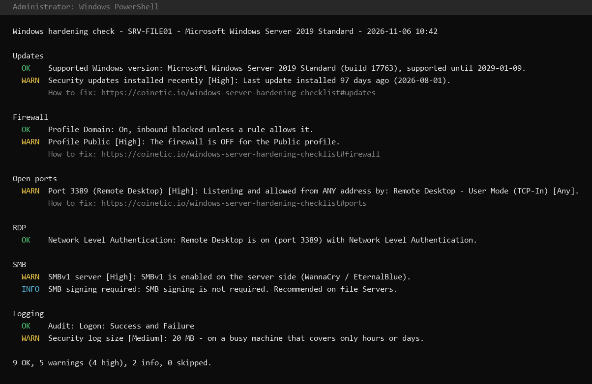

# Windows hardening tools

**Is your Windows Server hardened?** `Test-WindowsServerHardening.ps1` checks the network and logon side of a Windows Server or PC in about 10 seconds: firewall, open admin ports, RDP, SMB, updates, local accounts and logging. Each finding links to the explanation and the fix.



- **Read-only.** The script changes nothing, so it is safe on production Servers.
- **Nothing leaves the machine.** No network calls, no telemetry. One file you can read before you run it.
- **Any Windows language.** It reads settings through built-in commands and APIs, never by parsing translated text.
- **Free**, MIT licence.

## Quick start

Open **PowerShell as administrator** (without admin rights a few checks are skipped) and run:

```powershell
Invoke-WebRequest https://raw.githubusercontent.com/Coinetic-AI-Security/windows-hardening-tools/main/Test-WindowsServerHardening.ps1 -OutFile Test-WindowsServerHardening.ps1
Unblock-File .\Test-WindowsServerHardening.ps1
.\Test-WindowsServerHardening.ps1
```

If your execution policy blocks scripts: `powershell -ExecutionPolicy Bypass -File .\Test-WindowsServerHardening.ps1` (applies to this one run only).

Results as objects, for many Servers or for a report:

```powershell
.\Test-WindowsServerHardening.ps1 -Quiet | Export-Csv hardening.csv -NoTypeInformation
.\Test-WindowsServerHardening.ps1 -Quiet | Where-Object Status -eq 'WARN'
Invoke-Command -ComputerName SRV1, SRV2 -FilePath .\Test-WindowsServerHardening.ps1   # one report per Server
```

## What it checks

| Area | Checks | Background |
|---|---|---|
| Updates | supported Windows version, last installed update, Print Spooler on domain controllers | [Updates and attack surface](https://coinetic.io/windows-server-hardening-checklist#updates) |
| Firewall | all three profiles on, inbound blocked by default (incl. Group Policy), network profile of each connection | [Windows Firewall](https://coinetic.io/windows-server-hardening-checklist#firewall) |
| Open ports | RDP, SMB, NetBIOS, RPC, WinRM, SQL Server, MySQL, PostgreSQL, VNC, FTP, Telnet: listening **and** allowed from any address, with the rule and its profile | [Open ports](https://coinetic.io/windows-server-hardening-checklist#ports) |
| RDP | Network Level Authentication, port | [RDP hardening](https://coinetic.io/windows-server-hardening-checklist#rdp) |
| SMB | SMBv1 server and client, SMB signing (required on domain controllers) | [SMB and old protocols](https://coinetic.io/windows-server-hardening-checklist#smb) |
| Accounts | Guest account, built-in Administrator, LAPS | [Accounts and passwords](https://coinetic.io/windows-server-hardening-checklist#accounts) |
| Logging | audit policy for logons, lockouts, credential validation and account changes; advanced audit policy enforced; Security log size | [Logging](https://coinetic.io/windows-server-hardening-checklist#logging) |

Status: **OK** · **WARN** with severity High / Medium / Low · **INFO** (worth knowing, not wrong) · **SKIP** (could not be checked, e.g. without admin rights).

## Requirements

Windows PowerShell 5.1 (built into Windows 10 / 11 and Windows Server 2016 and later; Windows Server 2012 R2 with WMF 5.1). PowerShell 7 works too.

## Limits

- It checks the **Windows** side. Whether a port is reachable from the internet also depends on your router, cloud security group or upstream firewall.
- It is a **snapshot**. Settings drift with every update, installer and "quick test", so run it again regularly.
- It covers the points attacked most often, not the hundreds of settings in the [CIS Benchmarks](https://www.cisecurity.org/cis-benchmarks) or the Microsoft Security Baselines. Use those as the full reference.

## Keep it hardened

This script checks once. [Coinetic AI Security](https://coinetic.io) checks continuously on Windows Servers and PCs: it alerts when something switches the firewall off or opens a port to everyone, bans password guessers and port scanners automatically, and explains every finding in plain words. 30 days free.

## Feedback

Found a false alarm or a check that should be added? [Open an issue](https://github.com/Coinetic-AI-Security/windows-hardening-tools/issues). Please do not post host names, IP addresses or other details of your systems.

## Licence

[MIT](LICENSE) © 2026 Salus Alpha Group AG
